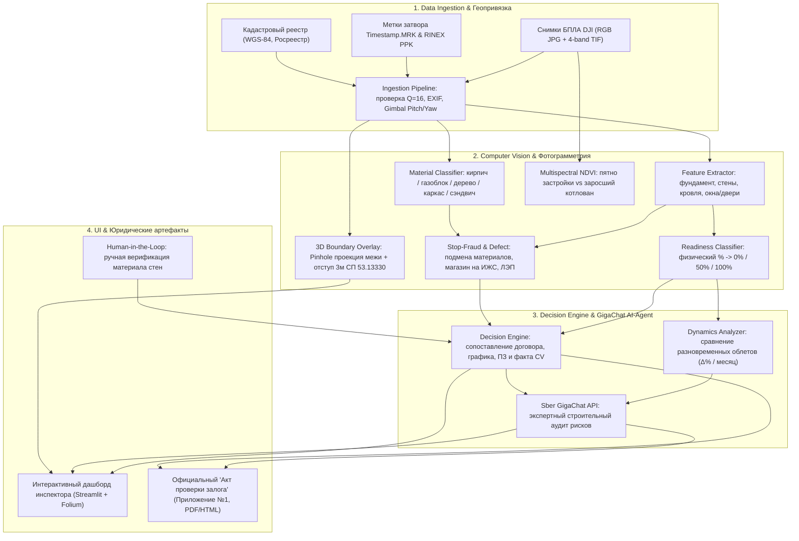

<div align="center">

# 🦅 AgentDrone: Интеллектуальный ИИ-агент мониторинга объектов ИЖС

### Автоматизированный аудит залогов, превентивный контроль кредитных рисков и фотограмметрический анализ аэрофотосъёмки БПЛА для Сбербанка

[](https://www.python.org/)
[](https://flake8.pycqa.org/)
[](https://docs.pytest.org/)
[](https://developers.sber.ru/)
[](https://streamlit.io/)
[](#веб-интерфейс-инспектора)
[](#о-команде)

**Команда:** Memento Vivere &nbsp;|&nbsp; **Заказчик:** Сибирский банк (Сбербанк), Блок работы с проблемными кредитами и правовыми вопросами

---

</div>

## 📌 О проекте и бизнес-контексте

В портфеле Сибирского банка находится свыше **17,8 тыс. кредитов на Индивидуальное жилищное строительство (ИЖС)**. Классический наземный мониторинг («ногами» на автомобиле) требует колоссальных ресурсов: инспекция 20 удалённых участков занимает **до 2 недель**, а себестоимость одного выезда достигает **30 000 ₽**. При этом инспектор с земли физически не видит кровлю, контур и геометрические нарушения границ.

**AgentDrone** — программный комплекс и автономный ИИ-агент, решающий эту задачу за счёт сквозного пайплайна:
1. **Сверхбыстрый сбор данных:** 20 участков облетаются дроном за **1 рабочий день**.
2. **Нулевой риск фрода (Stop-Fraud):** автоматическое выявление подмены проектных материалов (например, заёмщик взял 6 млн ₽ на кирпичный коттедж, а возвёл щитовой каркас за 800 тыс. ₽) и нецелевого использования (коммерческий магазин на землях ИЖС).
3. **Ликвидация NPL Lag:** превентивная фиксация остановки стройки за 2–3 месяца до наступления просрочки платежа.
4. **Автоматизация решений:** детерминированный выбор одной из **5 банковских стратегий** и моментальная генерация официального **«Акта проверки залога» (Приложение №1 для АС «Залоги» Сбербанка)** в векторном PDF с цифровой подписью.

---

## 🏛 Архитектура системы



---

## 🚀 Ключевые возможности

### 1. 🛰 Геопривязка, антиспуфинг и телеметрия БПЛА
* **Поддержка бортовой телеметрии DJI:** чтение меток срабатывания затвора `Timestamp.MRK` с миллиметровыми оффсетами фазового центра антенны и контролем качества фиксированного решения (`Q=16`).
* **Антиспуфинг и кадастровая валидация:** автоматическая привязка кадров к кадастровым номерам (формат `54:XX:XXXXXX:XXXX`), проверка удаления точки взлёта от центроида участка ($< 150$ м) и проекции луча оптической оси на кадастровый полигон.
* **Контроль регламента съёмки:** алгоритмическая проверка наличия обязательного комплекта ракурсов: **4 перспективных кадра фасадов** ($\text{GimbalPitch} \approx -45^\circ$) + **2 надирных кадра** ($\text{GimbalPitch} = -90^\circ$: низкий на кровлю и высокий обзорный на границы).

### 2. 👁 Компьютерное зрение и классификация готовности
* **Детекция конструктивных элементов:** раздельное распознавание фундамента ($15\%$), несущих стен ($40\%$), стропильной системы/кровли ($30\%$), контура окон и дверей ($15\%$).
* **Банковский нормативный маппинг:** вычисление физического непрерывного процента готовности и его приведение к 3-уровневой нормативной шкале Банка:
  * **0% (Старт / Котлован / Трава):** строительство не начато или приостановлено на нулевом цикле.
  * **50% (Коробка):** возведён фундамент, несущие стены, стропильная система.
  * **100% (Завершённый тёплый контур):** смонтирована кровля, остекление, входная группа — объект готов к залогу.
* **Классификатор материалов стен:** спектрально-текстурный анализ на фасадных ракурсах (Кирпич / Камень, Газобетонные блоки, Брус / Оцилиндрованное бревно, Каркасно-щитовой / SIP, Сэндвич-панели).
* **Ручная верификация (Human-in-the-Loop):** возможность инспектора в 1 клик скорректировать материал стен при спорных визуальных условиях с мгновенным пересчётом рисков и снятием флагов мошенничества.

### 3. 🛡 Stop-Fraud, детекция дефектов и фотограмметрия границ
* **Выявление подмены сметы (Stop-Fraud):** выявление несоответствия фактического материала проектному (например, дешёвый каркасник вместо кирпича) с заморозкой выдачи кредитного транша.
* **Нецелевое использование земель:** детекция коммерческих объектов на землях ИЖС (реализован реальный кейс из датасета — двухэтажный супермаркет с зоной разгрузки в г. Бердске).
* **Критические риски и дефекты:** фиксация отсутствия консервации стен на зиму, заросшего бурьяном котлована (признак долгостроя), опасного приближения к кронам деревьев и охранным зонам ЛЭП.
* **Фотограмметрическая 3D-проекция кадастровых границ:** честная Pinhole-проекция поворотных межевых точек WGS-84 на снимки с учётом ориентации подвеса ($\text{Yaw/Pitch/Roll}$), калиброванного фокуса камеры и коррекции дисторсии объектива, с отрисовкой нормативного **3-метрового отступа по СП 53.13330** (ст. 222 ГК РФ — риск судебного сноса самовольной постройки).
* **Мультиспектральный анализ (NDVI):** обработка 4-канальных спектральных снимков DJI M3M (`.TIF` — NIR, RedEdge, Red, Green) для отделения активных земляных работ от заброшенных участков.

### 4. 🧠 Матрица 5 целевых банковских стратегий (Decision Engine)
Детерминированный движок принимает решения для системы мониторинга залогов (**АС «Залоги» Сбербанка**) без галлюцинаций:

| Стратегия Банка | Условия срабатывания | Действие в системе залогов |
|:---|:---|:---|
| 🟢 **STRAT-01: Зелёный коридор** | Темп в графике, материалы по смете, просрочки нет (ПЗ = 0) | Автоматическое согласование и выплата очередного транша |
| 🟡 **STRAT-02: Реструктуризация** | Риск срыва сроков (до дедлайна $<6$ мес., готовность 50%), задержка транша | Направление на кредитные каникулы / дофинансирование |
| 🔵 **STRAT-03: Регистрация залога** | Объект готов на 100%, но отсутствует запись в ЕГРН | Юридическое содействие заёмщику в регистрации залога |
| 🟣 **STRAT-04: Аудит СБ (Фрод)** | Подмена материала (щит вместо кирпича) или коммерция (магазин) | Приостановка траншей, назначение внеплановой ревизии СБ |
| 🔴 **STRAT-05: Судебное взыскание** | Срок договора истекает ($<3$ мес.), готовность 0%, либо ПЗ 90+ дней | Передача дела в суд, реализация земельного участка на торгах |

### 5. 📈 Превентивный мониторинг динамики и ИИ-агент GigaChat
* **Анализ разновременных облётов:** автоматическое сопоставление хронологических снимков одного кадастрового участка (например, 2026 vs 2027 год) с расчётом прироста готовности $\Delta \%$, дней между облётами $\Delta t$, среднемесячного темпа строительства и статуса динамики (*Заморозка*, *Медленный*, *Умеренный*, *Высокий*).
* **Глубокий риск-аудит от GigaChat API:** ИИ-агент Сбербанка анализирует хронологию, кредитный лимит и физический прогресс, генерируя структурированное экспертное заключение для залоговой службы (выявление скрытых рисков срыва договора и обоснование санкций по траншам).

### 6. 📄 Юридический артефакт: «Акт проверки залога» (Приложение №1)
* Полное соответствие нормативной банковской форме Сбербанка для внесения в **АС «Залоги»**.
* Автоматическое включение реквизитов заёмщика, кредитного договора, геокоординат, таблицы дефектов, фототаблицы ракурсов, штампа ЭЦП и экспертного заключения GigaChat.
* Мгновенный экспорт в **векторный полиграфический PDF** (через Headless Chromium) и HTML.

---

## 🖥 Веб-интерфейс инспектора

Интерактивный дашборд разработан на **Streamlit** с соблюдением корпоративного гайдлайна Сбера:
* **Интерактивная карта НСО (Folium):** светофорная кластеризация рисков (зелёный / жёлтый / красный) и отображение точных контуров участков.
* **Инспектор снимков БПЛА:** просмотр 6 обязательных ракурсов с зумом колесом мыши, наложением красных межевых линий и поворотных точек 1..4.
* **Вкладка «📈 Динамика строительства»:** карточки ключевых KPI, сравнительная таблица полетов и блок взаимодействия с ИИ-агентом GigaChat.
* **Вкладка «📄 Акт проверки залога»:** предпросмотр официального документа с кнопками прямого скачивания PDF и HTML.
* **Менеджер датасета:** серверная загрузка архивов `.zip` и RAW-снимков с защитой от Path Traversal / Zip Slip и поддержкой ленивой загрузки (On-demand инференс запускается только при переходе к участку).

---

## 🛠 Стек технологий

| Направление | Технологии |
|:---|:---|
| **Язык разработки** | Python 3.10+ (протестировано на Python 3.14) |
| **Компьютерное зрение и геодезия** | OpenCV, Pillow, NumPy, ExifRead, Shapely, PyProj |
| **Искусственный интеллект и LLM** | Сбер GigaChat API (официальный SDK `gigachat`), Prompt Engineering |
| **Бизнес-логика и валидация** | Pydantic v2 (строгие контракты данных), Jinja2 (шаблонизация Актов) |
| **Веб-интерфейс и визуализация** | Streamlit, Folium, Streamlit-Folium |
| **Экспорт документов** | Headless Chrome Print-to-PDF, ReportLab, WeasyPrint |
| **Тестирование и качество кода** | PyTest (87 тестов), Pytest-Mock, Flake8 |

---

## 📦 Быстрый старт

### 1. Клонирование репозитория
```bash
git clone https://github.com/dprits/AgentDrone.git
cd AgentDrone
```

### 2. Создание и активация виртуального окружения
```bash
python3 -m venv .venv

# Linux / macOS:
source .venv/bin/activate

# Windows (PowerShell):
.venv\Scripts\Activate.ps1
```

### 3. Установка зависимостей
```bash
pip install --upgrade pip
pip install -r requirements.txt
```

### 4. Настройка переменных окружения (`.env`)
Скопируйте шаблон конфигурации и при необходимости укажите путь к датасету и ключ GigaChat API:
```bash
cp .env.example .env
```

Пример содержимого `.env`:
```env
# Путь к папке датасета (относительный или абсолютный)
DATASET_DIR=dataset

# Сбер GigaChat API (получить на https://developers.sber.ru/studio/)
GIGACHAT_CREDENTIALS=your_base64_client_id_secret_here
GIGACHAT_SCOPE=GIGACHAT_API_PERS
GIGACHAT_MODEL=GigaChat-2-Pro
```

> [!NOTE]
> Если ключ GigaChat API не задан, система автоматически переключается на встроенный **детерминированный оффлайн-fallback движок**, сохраняя полную работоспособность приложения и генерацию Актов без сбоев.

### 5. Загрузка демонстрационного датасета
В репозиторий встроен скрипт автоматической многопоточной выгрузки тестового датасета БПЛА с Яндекс Диска:
```bash
python download_disk.py
```
*Скрипт загрузит снимки 13 кадастровых участков НСО в каталог `dataset/` и проверит контрольные суммы файлов.*

---

## 🚦 Запуск приложения

### Локальный запуск (Streamlit UI):
```bash
streamlit run src/ui/app.py
```
После запуска откройте в браузере: `http://localhost:8501`.

### Продакшн запуск на сервере:
В проекте предусмотрен готовый скрипт запуска:
```bash
chmod +x run_server.sh
./run_server.sh
```

---

## 🧪 Тестирование и верификация (Executable Guardrails)

Качество кода проекта защищено строгими автоматическими тестами. Перед коммитом все модули верифицируются:

```bash
# Запуск полного набора юнит- и интеграционных тестов:
pytest tests/ -v

# Проверка соответствия стандартам PEP8 (линтер):
flake8 src/ tests/ --max-line-length=130
```

### Результат прогона тестов:
```text
======================== 87 passed, 1 warning in 9.85s ========================
- tests/test_adversarial.py .............. PASSED (антиспуфинг и защита)
- tests/test_cv.py ....................... PASSED (детекция элементов и стадий)
- tests/test_dataset_manager.py .......... PASSED (безопасность загрузки архивов)
- tests/test_dynamics.py ................. PASSED (разновременной анализ темпов)
- tests/test_engine.py ................... PASSED (матрица 5 стратегий банка)
- tests/test_gigachat.py ................. PASSED (LLM-аудит и оффлайн-фоллбэк)
- tests/test_ingestion.py ................ PASSED (телеметрия MRK, EXIF, углы)
- tests/test_manual_material_override.py . PASSED (Human-in-the-loop)
- tests/test_models.py ................... PASSED (Pydantic-контракты)
- tests/test_registry.py ................. PASSED (реестр кредитов ИЖС)
- tests/test_report.py ................... PASSED (генерация Акта в HTML/PDF)
- tests/test_sber_theme.py ............... PASSED (соответствие корпоративному UI)
- tests/test_ui_lazy_loading.py .......... PASSED (ленивая загрузка участков)
- tests/test_ui_parcel_management.py ..... PASSED (управление файлами)
```

---

## 📂 Структура проекта

```
AgentDrone/
├── DOMAIN.md                     # Отраслевой словарь терминов и стандарты Банка
├── AGENTS.md                     # Инструкции и правила для AI-агентов разработки
├── FEATURE_LIST.md               # Трекер задач и матрица приёмки фич
├── PROGRESS.md                   # Журнал спринтов и прогресса разработки
├── specs.md                      # Спецификация форматов данных БПЛА (DJI MRK/PPK)
├── requirements.txt              # Зависимости проекта
├── download_disk.py              # Автоматический загрузчик датасета с Яндекс Диска
├── run_server.sh                 # Скрипт серверного запуска приложения
├── data/
│   ├── registry.json             # Реестр 13 объектов ИЖС Сибирского банка
│   └── parcels_geometry.json     # Полигоны кадастровых границ (WGS-84)
├── src/
│   ├── config.py                 # Конфигурация и резолвер путей к данным
│   ├── dataset_manager.py        # Менеджер загрузки/удаления папок участков (Zip Slip guard)
│   ├── dataset.py                # Сканер и валидатор локальных наборов БПЛА
│   ├── models/                   # Строгие Pydantic v2 схемы данных:
│   │   ├── credit.py             # Кредитный договор и данные заёмщика
│   │   ├── dynamics.py           # Хронологические срезы и темпы строительства
│   │   ├── enums.py              # Стадии (0/50/100%), материалы, стратегии
│   │   ├── inspection.py         # Результаты CV-осмотра и дефекты
│   │   └── strategy.py           # Банковская стратегия и обоснование
│   ├── ingestion/                # Извлечение метаданных и геопривязка:
│   │   ├── telemetry_parser.py   # Парсинг Timestamp.MRK, EXIF и XMP
│   │   ├── angle_detector.py     # Классификация 4 фасадов + 2 надирных кадров
│   │   ├── cadastral_validator.py# Проверка удаления от центроида и антиспуфинг
│   │   └── credit_registry.py    # Менеджер кредитного портфеля ИЖС
│   ├── cv/                       # Ядро компьютерного зрения и фотограмметрии:
│   │   ├── feature_extractor.py  # Детекция фундамента, стен, кровли, окон
│   │   ├── readiness_classifier.py # Расчет непрерывного % и дискретный маппинг
│   │   ├── material_classifier.py# Распознавание материалов стен
│   │   ├── fraud_detector.py     # Stop-Fraud (подмена материалов, магазин на ИЖС)
│   │   ├── boundary_overlay.py   # Фотограмметрическая 3D-проекция границ и отступа 3м
│   │   ├── multispectral.py      # Мультиспектральный анализ (NDVI)
│   │   └── pipeline.py           # Фасад сквозного CV-пайплайна
│   ├── engine/                   # Бизнес-логика Банка:
│   │   ├── decision_engine.py    # Матрица 5 целевых стратегий урегулирования
│   │   └── dynamics_analyzer.py  # Анализ временных рядов динамики стройки
│   ├── gigachat_service/         # Интеграция с GigaChat API:
│   │   ├── prompts.py            # Банковские промпты строительного риск-аудита
│   │   └── service.py            # Клиент SDK Сбера с оффлайн-fallback
│   ├── report/                   # Генератор «Акта проверки залога»:
│   │   ├── generator.py          # Рендерер HTML и векторного PDF
│   │   └── templates/            # Jinja2 шаблон официального Приложения №1
│   └── ui/                       # Интерактивный дашборд (Streamlit):
│       ├── app.py                # Главное приложение дашборда инспектора
│       └── sber_theme.py         # Корпоративная тема и компоненты Сбера
└── tests/                        # 87 автоматических юнит- и интеграционных тестов
```

---

## 👥 О команде

Проект разработан командой **Memento Vivere** в рамках хакатона **{SIB}КОД 2026** (трек Сибирского банка Сбербанка):

* **Участник 1 (CV & Geo Lead):** Алгоритмы фотограмметрии, детекция конструкций и материалов, 3D-проекция кадастровых границ, Stop-Fraud модули - Смородников Дмитрий Евгеньевич.
* **Участник 2 (Backend & Decision Engine):** Pydantic-архитектура, матрица 5 банковских стратегий, интеграция GigaChat API, генератор официального Акта в PDF - Иванов Андрей Андреевич.
* **Участник 3 (Frontend & Lead):** Архитектура интерфейса инспектора Streamlit, картографический модуль Folium, UX разновременной динамики и менеджер датасета - Клоков Даниил Олегович.

---

<div align="center">

**AgentDrone** — делаем кредитный мониторинг прозрачным, быстрым и безопасным вместе со Сбером! 🚀

</div>
